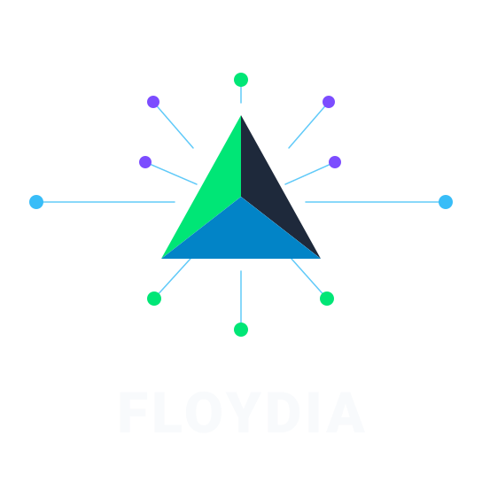
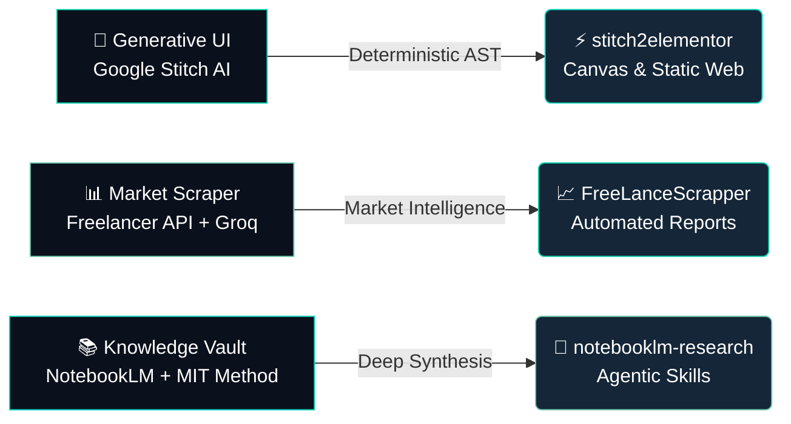

# ⚡ FloydIA • Web & IA Automation
### **"Construimos la inteligencia. Desde la infraestructura."**

 

> *"I don't just use tools. I build the tools that build your systems."*  
> **— Desde la infraestructura, todo.**

---

## 🏛️ Sobre FloydIA

**FloydIA** es la firma tecnológica fundada por **Eliú Hurtado**, orientada a democratizar la inteligencia artificial aplicada, la ingeniería de automatización y el desarrollo web de alta fidelidad para PyMEs, startups y empresas de estándar internacional.

A diferencia de las agencias convencionales que revenden interfaces genéricas o suscripciones a APIs ajenas, nos respaldan **+25 años de experiencia real en infraestructura IT, redes corporativas, seguridad electrónica y servidores Linux**. Construimos la infraestructura física y lógica sobre la que corre la inteligencia artificial, garantizando soberanía de datos, costos predecibles y entregas en días.

---

## 🚀 Proyectos Insignia & Ecosistema de Herramientas

### 🌟 Repositorios Destacados:

**1. [floydia-suite-desktop](https://github.com/floydiamarkv-byte/floydia-suite-desktop)** — *Desktop Command Center & AI Orchestrator* (`PyQt6`, `MIT`, CI verde en Python 3.10–3.13)

   Centro de mando unificado para Linux Desktop que opera flotas de modelos LLM: telemetría en vivo (latencia, TTFT, TPS, cuotas 402/429), catálogo de 400+ modelos, cockpit de servidores MCP, propagación atómica y auditable de configuración a OpenCode / Hermes / DeepSeek Harness, gestor multi-cuenta de APIs, limpiador BleachBit con allowlist de rutas protegidas y SRE Governor. 58 tests, job de secret scan con gitleaks, `SECURITY.md` y `CONTRIBUTING.md`.
   

**2. [floydia-ai-observatory](https://github.com/floydiamarkv-byte/floydia-ai-observatory)** — *AI Command & Observatory Suite* (`Python`, `MIT`, 65 tests)

   Agrega y normaliza métricas de 8 fuentes de benchmark (Arena.ai, SWE-bench Verified, Aider Polyglot, Artificial Analysis, Hugging Face Open LLM, LiveBench, Epoch AI y catálogo vivo de OpenRouter), con telemetría del clúster, detección de deriva, export de snapshots y motor de inyección de configuración para los agentes. Score de inteligencia y coding con trazabilidad por métrica.
   

**3. [floydia-agent-skills](https://github.com/floydiamarkv-byte/floydia-agent-skills)** — *Autonomous Agent Skills Catalog* (`Python`, `MIT`)

   Catálogo de skills agénticas de producción (harness multi-motor, orquestador arquitecto, research profundo, SRE, motor de evidencia y handoff) con contrato de cero fugas de credenciales y portable entre harnesses (OpenCode, Antigravity, Hermes).

**4. [stitch2elementor](https://github.com/floydiamarkv-byte/stitch2elementor)** — *The Universal Deterministic Bridge*

   Compila interfaces generadas en Google Stitch AI directamente a WordPress Elementor Flexbox Containers (`elType: "container"`) y sitios estáticos de ultra-alta velocidad. Cero alucinaciones, 27 reglas anti-error integradas y arquitectura 100% determinista.

**5. [FreeLanceScrapper](https://github.com/floydiamarkv-byte/FreeLanceScrapper)** — *AI-Powered Market Intelligence*

   Pipeline automatizado de inteligencia de mercado freelance. Extrae proyectos en tiempo real de Freelancer.com, los sintetiza con Groq LLM (Llama 3.3 70B) y distribuye alertas ejecutivas por Telegram, Email y Google Drive.

**6. [notebooklm-research](https://github.com/floydiamarkv-byte/notebooklm-research)** — *Deep Agentic Research Engine*

   Skill agéntica para investigación y síntesis profunda utilizando el Método MIT (5 Modelos Mentales, Debates Expertos y MOC Vault) conectado a Google NotebookLM.

---

## 🛠️ Stack Tecnológico & Especialidades

| Dominio | Tecnologías & Herramientas |
|---|---|
| **Agentic AI & LLMs** | Google Antigravity, MCP (Model Context Protocol), Groq LLM (Llama 3.3), FastMCP, NotebookLM |
| **Web Engineering** | Google Stitch, WordPress Elementor (Atomic Flexbox v4), TailwindCSS, Astro, Vite, Vanilla JS/Node.js |
| **Automation & Pipelines** | Python 3.11+, Bash scripting, Playwright headless, Crawl4AI, Telegram Bot API, Gmail SMTP, Google Drive API |
| **Infraestructura & Servidores** | Linux (Ubuntu, Debian), Proxmox VE (LXC/KVM), Docker, Nginx, Redes Corporativas, MikroTik |

---

## 📬 Conecta con FloydIA

- 🌐 **Sitio Web Oficial**: [https://floydia.site](https://floydia.site)
- 💬 **WhatsApp Directo**: [+58 412-2532932](https://wa.me/584122532932)
- 💼 **LinkedIn Fundador**: [Eliú Hurtado](https://linkedin.com/in/eliutec)
- 📧 **Contacto Directo**: `floydiamarkv@gmail.com`

---

**FloydIA Labs** • *Engineering the Autonomous Future.*  
Distributed under the [MIT License](https://opensource.org/licenses/MIT)

